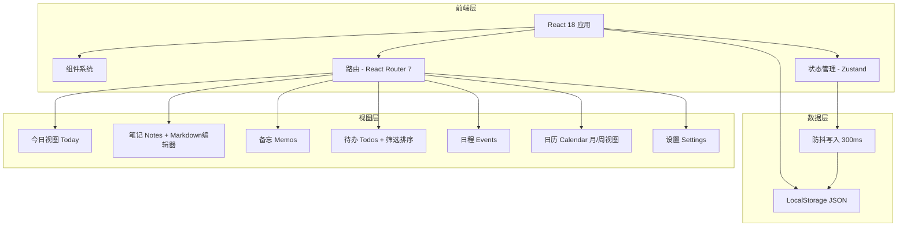
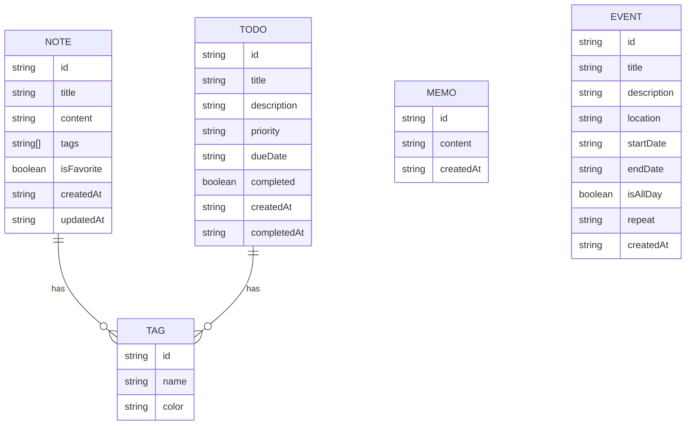

## 1. 架构设计



## 2. 技术栈（实际）

- **前端框架**：React@18 + TypeScript@5.8
- **样式方案**：Tailwind CSS@3（darkMode: "class"）
- **构建工具**：Vite@6
- **状态管理**：Zustand@5（非 Context）
- **路由**：React Router@7
- **Markdown 解析**：react-markdown + remark-gfm
- **日期处理**：date-fns@3
- **图标库**：lucide-react
- **本地存储**：localStorage（JSON 格式，300ms 防抖写入，versioned payload）
- **ID 生成**：crypto.randomUUID（优先）/ fallback

## 3. 路由定义

| 路由 | 用途 |
|-------|---------|
| / | 今日视图 - 首页 |
| /notes | 笔记列表 + 编辑器 |
| /notes/:id | 笔记详情/编辑（路由参数自动选中） |
| /memos | 备忘列表 |
| /todos | 待办列表 + 筛选排序 |
| /events | 日程列表 |
| /calendar | 日历视图（月视图/周视图切换） |
| /settings | 设置页面（主题/导入导出/重置） |

## 4. 数据模型（与 types/index.ts 一致）



## 5. 实际组件结构

```
src/
├── components/
│   ├── layout/
│   │   ├── Sidebar.tsx         # 侧边导航 + 移动端折叠
│   │   └── Topbar.tsx          # 顶部搜索栏 + 日期显示
│   └── ui/
│       ├── Button.tsx          # 通用按钮
│       ├── Modal.tsx           # 弹窗（ESC关闭/点击遮罩关闭）
│       ├── ConfirmDialog.tsx   # 确认对话框
│       ├── EmptyState.tsx      # 空状态组件
│       └── index.ts            # 统一导出
├── hooks/
│   └── useTheme.tsx            # ThemeContext + useTheme hook + ThemeProvider
├── lib/
│   └── utils.ts                # cn() - clsx + tailwind-merge
├── store/
│   └── index.ts                # Zustand AppStore（CRUD + replaceAll）
├── types/
│   └── index.ts                # 类型定义（Note/Memo/Todo/Event/Tag/Priority/RepeatType）
├── utils/
│   └── storage.ts              # load/save/import/reset/generateId/nowISO
├── pages/
│   ├── Today.tsx               # 今日概览 + 待办/日程列表
│   ├── Notes.tsx               # 笔记列表 + Markdown编辑器 + 标签筛选
│   ├── Memos.tsx               # 备忘列表 + 快捷输入 + 转为待办
│   ├── Todos.tsx               # 待办列表 + 筛选排序工具栏 + 动画
│   ├── Events.tsx              # 日程列表 + 新增弹窗
│   ├── Calendar.tsx            # 月视图/周视图 + 日期详情面板
│   └── Settings.tsx            # 主题切换 + 导出/导入/重置数据
├── App.tsx                     # 根组件 + 路由 + 移动端汉堡菜单
├── main.tsx                    # 入口 + ThemeProvider 包裹
└── index.css                   # Tailwind base + Markdown样式 + 暗色模式 + 动画 + 响应式
```

## 6. 存储策略

- **自动保存**：每次数据变更触发 300ms 防抖写入 localStorage
- **数据结构**：`{ version: number, data: AppState }` 版本化 JSON
- **数据校验**：`sanitize()` 函数校验导入数据完整性
- **初始化数据**：首次使用时创建固定 ID 的示例数据
- **数据备份**：支持 JSON 导出/导入/重置
