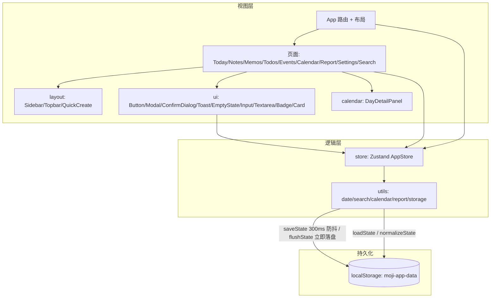

# 墨集 · 架构说明

> 本文档描述当前实现（React 18 + TypeScript + Vite + Zustand + localStorage）。设计规范见 [design.md](./design.md)，测试规范见 [testing.md](./testing.md)。

## 1. 概览

墨集是纯前端、离线优先的一站式日程管理应用：笔记（Markdown）、备忘、待办、日程、日历、周报、全局搜索与数据导入导出。无后端、无账号，数据保存在浏览器 `localStorage`；同时提供 PWA 离线安装、Electron 桌面壳与 Node SEA 单文件打包三种分发形态。



## 2. 技术栈（实际）

| 类别 | 选型 |
|---|---|
| 框架 | React 18 + TypeScript 5.8（`strict: false`，`noUnusedLocals/Parameters: false`） |
| 构建 | Vite 6（`base: './'`，hidden sourcemap，react-markdown 独立 chunk） |
| 样式 | Tailwind CSS 3（`darkMode: "class"`）+ `src/index.css` 设计工具类 |
| 状态 | Zustand 5（单 store，无持久化中间件，自行防抖写 localStorage） |
| 路由 | React Router 7（`BrowserRouter`，页面 `lazy` + Suspense） |
| Markdown | react-markdown + remark-gfm |
| 日期 | date-fns 3（`zhCN`） |
| 图标 | lucide-react（1.5px 线宽） |
| 动画 | framer-motion（页面过渡）+ CSS keyframes（列表/弹窗） |
| 测试 | Vitest 4 + Testing Library + jsdom + v8 coverage |
| PWA | vite-plugin-pwa（`prompt` 更新、Workbox 运行时缓存） |
| 打包 | Electron 43（便携版）/ Node SEA（`scripts/`） |

## 3. 目录结构

```
.
├── docs/                   # arch.md / design.md / testing.md / prd.md（历史稿）
├── electron/main.cjs       # Electron 主进程（开发连 5173，生产 loadFile dist）
├── public/                 # favicon、PWA 图标、scenes/ 水墨场景 SVG
├── scripts/                # server.cjs（SEA 入口静态服务器）、sea-config.json、pack-step*.cjs、pack-clean.cjs
├── src/
│   ├── components/
│   │   ├── layout/         # Sidebar、Topbar、QuickCreate
│   │   ├── calendar/       # DayDetailPanel（桌面侧栏 / 移动抽屉复用）
│   │   ├── ui/             # Button/Modal/ConfirmDialog/Toast/EmptyState/Input/Textarea/Badge/Card + toast-context
│   │   ├── ErrorBoundary.tsx
│   │   └── PWARegister.tsx # 安装提示 / 离线就绪 / 新版本更新
│   ├── hooks/              # useTheme、useMediaQuery、useDebouncedValue
│   ├── lib/utils.ts        # cn() = clsx + tailwind-merge
│   ├── pages/              # Today/Notes/Memos/Todos/Events/Calendar/Report/Settings/SearchResults
│   ├── store/index.ts      # Zustand AppStore（CRUD + 级联 + snapshot/replaceAll）
│   ├── test/               # setup.ts、render.tsx、fixtures.ts
│   ├── types/index.ts      # Note/Memo/Todo/Event/Tag/Priority/RepeatType 等
│   ├── utils/
│   │   ├── date.ts         # 日键 / ISO / 时间串契约
│   │   ├── calendar.ts     # 日索引、周视图布局、循环展开
│   │   ├── search.ts       # 全局搜索（Topbar + SearchResults 共用）
│   │   ├── report.ts       # 周范围与周报统计 / Markdown 导出
│   │   └── storage.ts      # 读写、防抖、flush、sanitize、normalize、导入导出
│   ├── App.tsx             # 路由 + 布局壳（导出 AppContent 便于测试）
│   ├── main.tsx            # 入口：Theme/Toast Provider、PWA、卸载前 flush
│   └── index.css           # Tailwind + 水墨工具类 + 动效 + 暗色
├── index.html
└── 配置：vite.config.ts / tsconfig*.json / tailwind.config.js / postcss.config.js / eslint.config.js
```

## 4. 路由

| 路由 | 页面 | 说明 |
|---|---|---|
| `/` | Today | 今日概览、今日待办/日程（循环日程展开） |
| `/notes`、`/notes/:id` | Notes | 列表 + 编辑器；URL 与选中态双向同步 |
| `/memos` | Memos | 速记；`?new=1` 聚焦输入 |
| `/todos` | Todos | 筛选/排序；`?new=1` 打开新建 |
| `/events` | Events | 列表 + 新建/编辑弹窗；`?new=1` |
| `/calendar` | Calendar | 月/周视图；`?date=yyyy-MM-dd` 定位（消费后清除） |
| `/report` | Report | 周报；支持前后翻周 |
| `/settings` | Settings | 主题、标签管理、数据导入导出重置 |
| `/search` | SearchResults | `?q=` 全局搜索结果 |

页面均 `lazy` 加载，`AnimatePresence` 做淡入过渡；笔记页与搜索页隐藏桌面 Topbar（自成布局）。

## 5. 状态与数据流

- 单一 Zustand store（`useAppStore`），状态即 `AppState`（notes/memos/todos/events/tags）+ CRUD actions。
- 所有写操作走内部 `commit(next)`：合并 → 取业务数据 → `saveState()`（300ms 防抖）→ `set()`。
- `snapshot()` 返回五组数据的浅拷贝，供设置页导出当前状态（不读 localStorage，避免拿到防抖窗口内的旧值）。
- `replaceAll(state)` 用于导入/重置：立即 `saveState(state, true)` 后整体替换。
- 级联规则在 store 内：
  - `updateTag(id, { name })`：改名时同步重写所有笔记的 `tags` 名称。
  - `deleteTag(id)`：从所有笔记中移除该标签名。
  - `updateTodo`/`toggleTodo`：维护 `completed ⇔ completedAt` 不变量。
- 页面通过选择器订阅所需分片（`useAppStore(s => s.todos)`），避免无关重渲染。
- 主题在 `ThemeProvider`（Context + `localStorage.theme`）；Toast 在 `ToastProvider`（Context，3s 自动消失）。

## 6. 数据模型与契约

```ts
Note  { id, title, content, tags: string[], isFavorite, createdAt, updatedAt }
Memo  { id, content, createdAt }
Todo  { id, title, description?, priority: 'high'|'medium'|'low', dueDate?: DayKey, completed, createdAt, completedAt? }
Event { id, title, description?, location?, startDate: ISO, endDate?: ISO, isAllDay, repeat: 'none'|'daily'|'weekly'|'monthly', createdAt }
Tag   { id, name, color }
```

**日期契约**（`src/utils/date.ts`）：

| 字段 | 表示 | 说明 |
|---|---|---|
| `Todo.dueDate` | 本地日键 `yyyy-MM-dd` | 只表达「哪一天到期」，不含时间，不受时区偏移影响 |
| `Event.startDate/endDate` | ISO 字符串 | 表单用 date + time 组合，经 `combineDateTime` 转 ISO |
| 日键解析 | `parseDayKey` → 本地零点 | 不把日键交给 `new Date()`（会按 UTC 解析） |
| 日键生成 | `toDayKey` | 统一本地时区；非法输入返回 `''` |

**循环日程语义**：`repeat` 只在展示层展开（`utils/calendar.ts#expandOccurrences`），生成与原事件同 id 的虚拟出现，不改库；编辑/删除作用于整条序列。不支持例外日期与单次修改。视图 key 使用 `${id}-${startDate}`。

**周范围**：周一起始，`getWeekRange(offsetWeeks)` 返回周一 00:00:00.000 ~ 周日 23:59:59.999；周报基于该范围统计。

## 7. 持久化与导入导出

- 存储键 `moji-app-data`，载荷 `{ version: 1, data: AppState }`；兼容旧版「裸 AppState」。
- 写入：`saveState` 保留最后一次 `pendingState`，300ms 防抖；`flushState()` 立即写出（`main.tsx` 在 `beforeunload`/`pagehide`/`visibilitychange(hidden)` 调用）。
- 读取：`loadState()` → `normalizeState()`（条目级 sanitize + 旧 `dueDate` 迁移 + 非法日程丢弃并 warn）。
- 导入：`importState(json)` 全量校验后才返回数据，失败返回 `{ ok: false, error }`；设置页在成功时 `replaceAll`，失败时状态不变并 Toast。
- 导出：设置页使用 `snapshot()`，文件名 `moji-backup-YYYY-MM-DD.json`。
- 初始演示数据（欢迎笔记/备忘/待办/日程/标签）在首次加载且无存储时写入。

## 8. 设计系统与样式

- 令牌集中在 `tailwind.config.js`（ink/vermilion/rattan/paper/success、paper 阴影、`ease-zen`）与 `src/index.css`（`bg-zen`、`glass`、`brush-divider`、`lift-on-hover`、`seal`、动效 keyframes、reduced-motion）。
- 字体全部本地回退（Noto Serif/Sans SC → Songti/SimSun/PingFang/雅黑），不依赖远程字体，保证离线。
- 暗色模式通过 `html.dark` 切换；暗色下用描边代替阴影。
- 组件规范、页面规范、无障碍与文案规范见 [design.md](./design.md)。

## 9. PWA、桌面与打包

- `vite-plugin-pwa`：`registerType: 'prompt'`，`injectRegister: false`，由 `PWARegister` 手动注册并展示「发现新版本 / 已可离线 / 安装到桌面」提示；Workbox 对 document 用 NetworkFirst，静态资源 StaleWhileRevalidate，图片字体 CacheFirst。
- `npm run serve`：`scripts/server.cjs` 启动 8099 端口静态服务器（SPA fallback），同时是 Node SEA 打包入口。
- `npm run pack`：`build` → `node --experimental-sea-config` → 复制 node.exe → postject 注入 blob → 复制 dist → 清理，产出 `release/墨集.exe`。
- `npm run electron:dev/build`：Electron 开发/便携版（`electron-builder --win portable`）。

## 10. 工程门禁

```bash
npm run check          # tsc -b --noEmit
npm run lint           # ESLint（0 error / 0 warning）
npm test               # vitest run
npm run test:coverage  # 覆盖率（utils/store ≥90%，ui/hooks ≥85%，全局 ≥70% 行）
npm run verify         # check + lint + coverage
npm run build          # tsc + vite build（含 PWA 产物）
```

测试分层、基础设施（setup/render/fixtures）、覆盖率门槛与手工 QA 清单见 [testing.md](./testing.md)。

## 11. 扩展指南

- **新增页面**：`src/pages/X.tsx` → `App.tsx` 增加 lazy 路由 → Sidebar 增加导航 → 复用 `renderWithProviders` 写页面测试 → 更新 design.md 第 5 节。
- **新增状态字段**：`types/index.ts` → `storage.ts` 的 `sanitize*/normalizeState` 补默认与迁移 → `store.snapshot/replaceAll` 无需改动（按 AppState 展开）→ 补 storage 测试。
- **新增 UI 组件**：`components/ui/` + `index.ts` 导出 + `__tests__` + design.md 登记。
- **新增纯逻辑**：放 `utils/` 并配套测试；不要写进页面组件（页面只做编排与展示）。
- **修改持久化/日期语义**：必须同时更新 `docs/design.md`、`docs/testing.md` 与本文件第 6/7 节。
